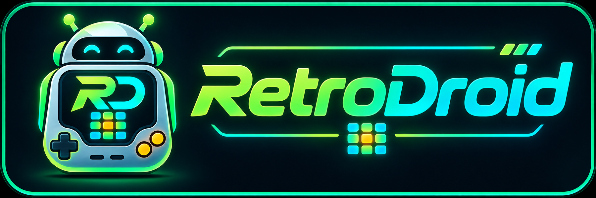

# RetroDroid

<p align="center">
  
</p>

<p align="center">
  <a href="https://aloyshf.github.io/RetroDroid/"></a>
  <a href="https://github.com/AloysHF/RetroDroid/actions/workflows/ci.yml"></a>
  <a href="https://github.com/AloysHF/RetroDroid/actions/workflows/android.yml"></a>
  <a href="https://github.com/AloysHF/RetroDroid/releases/latest"></a>
  <a href="https://github.com/AloysHF/RetroDroid/releases"></a>
  <a href="https://sonarcloud.io/dashboard?id=AloysHF_RetroDroid"></a>
  <a href="LICENSE"></a>
  <a href="android/app/build.gradle.kts"></a>
  <a href="https://discord.gg/E4SQjXUkZy"></a>
  <a href="https://qm.qq.com/q/LAO7DKAWUC"></a>
</p>

An all-in-one libretro frontend for Android. One APK, nine systems, no
in-app core downloads: every emulator core ships inside the app and is updated
together with the app.

RetroDroid is the Android companion of the emulator family developed under
[AloysHF](https://github.com/AloysHF):

| System | Core | License |
| --- | --- | --- |
| Native32 (Sunplus SPG) | `native32emu` | BSD-3-Clause |
| WooBooKong / SPMP8000 | `spmp8000` | BSD-3-Clause |
| Coolbar (MTK) | `coolbar` | BSD-3-Clause |
| Dingoo A320 | `dingoo` | BSD-3-Clause |
| HyperScan | `hyperscan` | BSD-3-Clause |
| Playdia | `playdia` | BSD-3-Clause |
| BBK electronic dictionary | `bbkemu` | GPL-3.0 |
| LavaX | `lavax` | GPL-3.0 |
| WQX (文曲星) | `wqx` | GPL-3.0 |

RetroDroid itself is BSD-3-Clause (see [LICENSE](LICENSE)). Bundled core
binaries keep their own license; their sources live in the corresponding
repositories.

## Status

Work in progress. The frontend, the Android UI and the core adaptions are
landed incrementally; see `git log` for the current state.

## How it works

```
┌──────────────────────────────────────────────┐
│ Kotlin / Jetpack Compose UI                  │
│  system list · fixed on-device library       │
├──────────────────────────────────────────────┤
│ JNI  (com.aloyshf.retrodroid.core.NativeCore)│
├──────────────────────────────────────────────┤
│ Rust frontend  (crates/retro-frontend)       │
│  dlopen core · env callbacks · video blit    │
│  audio ring buffer · input · save states     │
├──────────────────────────────────────────────┤
│ libretro cores (jniLibs/<abi>/*.so)          │
└──────────────────────────────────────────────┘
```

- Cores are loaded from the APK's native library directory at runtime; there is
  no network access for core management.
- ROMs and firmware are user-supplied. RetroDroid never bundles copyrighted
  content.
- Each core describes itself with an `android.json` profile; the app builds its
  system registry from those files, so adding a system is adding a core and a
  profile.

The interface every core must satisfy is documented in
[docs/Core-Contract.md](docs/Core-Contract.md).

## Using the app

RetroDroid reads games and firmware from one fixed folder on the device, so
there is nothing to pick on every launch:

```
/sdcard/RetroDroid/
├── ROMs/
│   ├── native32/
│   ├── coolbar/
│   ├── dingoo/
│   ├── hyperscan/
│   ├── lavax/
│   ├── playdia/
│   ├── spmp8000/
│   ├── wqx/
│   └── bbk/
└── BIOS/
    ├── bbk/
    │   ├── a4980/          8.BIN, E.BIN
    │   └── a4988/          8.BIN, E.BIN (optional model)
    ├── coolbar/            coolbaremu_orientation.csv (optional)
    ├── hyperscan/          spg290.bin, hyperscan.bin
    └── wqx/
        ├── nc1020/         obj_lu.bin, nc1020.fls
        ├── pc1000/         pc1000.rom, pc1000.nor
        ├── cc800/          obj.bin, cc800.fls
        ├── nc2000/         nc2000.nor, nc2000.nand, nc2000.nand0
        └── nc3000/         nc3000.nor, nc3000.nand, nc3000.nand0
```

1. On first launch, grant `All files access` so the app can read the library.
   The folder tree is created automatically; drop game files into the
   subfolder of their system.
2. Firmware and support files live in `BIOS/<system>/`, with one subfolder per
   model on systems whose core loads model-specific files (BBK a4980/a4988, the
   WQX models). Coolbar's optional orientation profile goes directly in
   `BIOS/coolbar/`. File and folder names are case-sensitive. The game list
   shows the exact paths a system still needs; matching files are copied into
   the shared private system root on refresh, where every core reads
   `<system>/<core>/…` (for example `bbkemu/a4980/8.BIN`). Only systems with
   support files get a `BIOS/<system>/` folder.
3. Select a game to start it. WQX has no game content: every supported model is
   listed on its own row with the folder its dumps belong to and whether that
   firmware is present, so pick the model and press **Start firmware**. The
   pause menu offers five save slots with previews, screenshots, embedded
   settings (theme, orientation, rotation and scaling), core options and exit.
   Leaving a game writes an automatic save; the next launch offers to continue
   from it. The back gesture returns to the game list.

Games are opened in place from the library. Folders below `ROMs/<system>/` are
listed before the games of the current folder and open one level at a time, so
a large library stays browsable; the back arrow and the back gesture step out
of a folder one level. For disc-based systems keep the `.cue` sheet next to its
tracks (`ROMs/playdia/game.cue` and `ROMs/playdia/game.bin`).

### Launching from a front-end

Android front-ends such as Tianma G (天马G) or ES-DE can start games directly:
the file extension picks the system, and leaving the game returns to the
calling front-end. `All files access` must be granted once beforehand, and
extensions shared by several systems (`.bin`, `.cue`, `.zip`) ask which one to
use.

Tianma G-style per-system entry:

```text
extensions: <the extensions that system accepts>
launch: am start
 -n com.aloyshf.retrodroid/.MainActivity
 -a android.intent.action.VIEW
 -d file://{file.path}
```

The `ROM` string extra works too, as do the `rom`, `path` and `game_path`
spellings, and `content://` URIs (copied into the app cache before play):

```text
am start -n com.aloyshf.retrodroid/.MainActivity -e ROM "{file.path}"
```

## Building

Requirements: Rust with the Android targets, the Android NDK (r27+), JDK 17+,
and the Android SDK.

```bash
rustup target add aarch64-linux-android x86_64-linux-android
cargo install cargo-ndk
export ANDROID_NDK_HOME=/path/to/android-ndk
export ANDROID_SDK_ROOT=/path/to/android-sdk

# Build the frontend, every core and the APKs.
./scripts/build-apk.sh                    # debug
./scripts/build-apk.sh assembleRelease    # release
```

The core sources are cloned from GitHub into `build/sources/`. To build a core
from a local checkout instead:

```bash
cp cores/local.env.example cores/local.env
# RETRODROID_NATIVE32_SOURCE=/path/to/Native32Emu
```

Outputs land in `android/app/build/outputs/apk/`: per-ABI APKs
(`arm64-v8a`, `x86_64`) plus the universal APK. CI builds the same set on every
push, the release workflow attaches them to the release on `v*` tags, and the
rolling `nightly-build` prerelease carries the latest master APKs.

## Legal

RetroDroid does not include games or console firmware. Users must own the
content they run. The three GPL-3.0 cores are bundled as separate dynamic
libraries and their complete sources are published in their own repositories.
